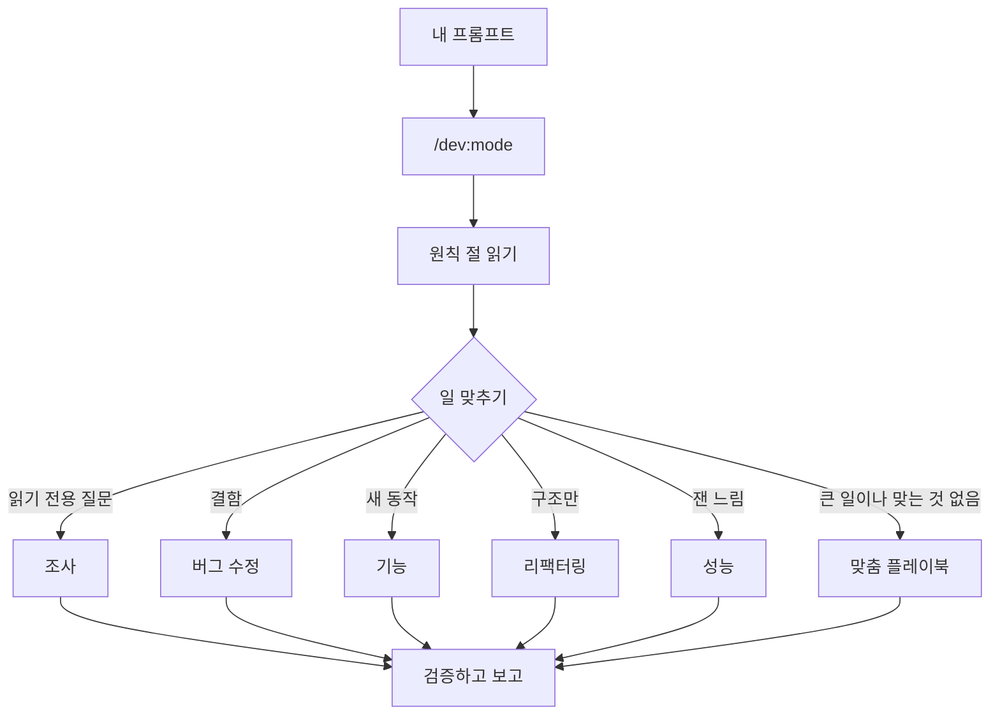

# `/dev:mode` 로 일 보내기

`/dev:mode` 가 정문이다. 목표를 주면 플레이북 스물두 개 가운데 하나를 고르고, 그 단계를 작업 목록에 옮기고, 단계에 필요한 다른 스킬을 부른다. 이 장에서는 좋은 프롬프트가 어떤 모양인지, 그리고 실제로는 얼마나 조금만 있으면 되는지 배운다.


## 프롬프트가 거치는 길



그림은 흔한 길만 보인다. 지표 힐클라임, 런타임 증상과 잡아 둔 트레이스 진단, 시제품, 화면 일치, 스킬 작성과 평가, 자율 실행, PR 열기, PR 이나 스택을 머지 준비까지 돌보기, 검증된 스택 내보내기, PR 큐나 스택을 오토파일럿으로 돌리기, 세션 이어받기, 안전하게 멈추기, 여러 단계 계획, 워크트리 정리 플레이북도 있다. 전체는 [플레이북 폴더](../../skills/mode/playbooks/) 에 있다.

## 격식 말고 목표를 말한다

명세를 쓰지 않는다. 무엇이 잘못됐는지나 무엇을 원하는지, 그리고 에이전트의 시간을 아껴 줄 이미 아는 것을 말한다.

```text
/dev:mode 재시도 뒤에 사용자에게 알림이 두 번 간다. 먼저 재현하고, 그다음 고치고 검증해.
```

버그 수정 프롬프트다. 「먼저 재현」은 예의가 아니라 진짜 제약이고, 플레이북이 그것을 지킨다. 작업 목록이 버그 수정 단계로 채워지는 것을 본다.

## 프롬프트에 넣을 것

쓸모 있는 프롬프트에는 다섯 가지까지 들어가고, 하나하나가 한 문장이면 된다.

- **목표.** 무엇이 잘못됐는지, 무엇을 원하는지 말한다.
- **완료 확인.** 통과하거나 실패할 수 있어야 한다. 「더 좋게 해」와 「한 시간 동안 해」는 확인이 아니다.
- **보고 싶은 증거.** 실제 명령 출력, 흐름을 찍은 영상, 저장된 값, 전후 숫자를 달라고 한다.
- **이미 아는 것.** 증상, 재현 단계, 로그 한 줄, 링크가 에이전트의 찾기 한 번을 아낀다.
- **진짜 제약.** 「먼저 재현」, 「아직 코드는 바꾸지 마」, 「동작 변화 없이」, 「진행하기 전에 내가 검토할게」는 저마다 에이전트가 하는 일을 바꾼다.

다섯을 다 넣은 프롬프트다.

```text
/dev:mode 어제 배포 뒤로 csv 내보내기가 마지막 행을 빠뜨린다. 실패한 작업 id 는 4812. 먼저 재현하고, 그다음 고쳐. 6만 행 픽스처가 모든 행을 내보내면 끝이다. 전후 행 수를 보여 줘.
```

빼는 것이 나은 것이 둘 있다.

- **방법.** 무엇을 이룰지만 말하고, 내가 고를 길보다 나은 길을 에이전트가 찾을 여지를 남긴다. 스킬 목록도 마찬가지다. 아래 함정에서 다룬다.
- **처음부터 내 원인 짐작.** 짐작을 말하면 찾기가 내가 가리킨 곳으로 좁아진다. 에이전트가 문제를 다시 말하게 한 뒤에 짐작을 꺼낸다.

긴 스레드나 흐릿한 버그처럼 잡음 많은 보고라면 다시 말하기를 첫 단계로 둔다.

```text
/dev:mode 이 스레드 읽어. 밑에 깔린 문제를 네 말로, 쉬운 말로 다시 적어. 아직 코드는 바꾸지 마.
```

잘못 읽었으면 코드가 생기기 전에 다시 말하기에서 드러난다. 거기서 바로잡으면 잘못된 고침 하나 대신 메시지 하나로 끝난다. `/dev:mode` 는 첫 메시지에서 늘 목표와 그것을 채우는 가장 작은 변경을 자기 말로 다시 적는다. 플레이북 없이 다시 말하기만 원하면 `/dev:mode` 를 붙이지 말고 「내 목표와 풀려는 문제를 네 말로 다시 적어 줘」라고 묻는다.

프롬프트가 제대로 겨눴는지 모르겠으면 보내기 전에 [`/dev:sharpen`](../../skills/sharpen/SKILL.md) 을 돌린다.

```text
/dev:sharpen v2 설정 형식으로 옮기는 안내서를 써.
```

에이전트는 이 분야 최고 전문가가 내가 청하지 않은 무엇을 할지, 그들이 시작할 가장 날것의 재료, 그들이 쓸 방법과 도구, 그리고 나나 에이전트 말고 무엇이 결과가 맞다는 것을 보여 줄지 말한다. 그다음 정확히 그것을 청하게 프롬프트를 다시 쓴다. 더 크게가 아니라 더 깊게다. 다시 쓴 프롬프트는 실험으로 정할 수 있는 선택은 에이전트가 시제품으로 정하고 관찰한 것에 근거해 하나를 추천하게 하고, 제품과 취향의 선택은 나에게 남긴다. 일 자체는 하지 않는다. 다시 쓴 것을 읽고, 예를 들어 `/dev:mode` 로 보낸다.

## 이어 말할 때는 짧게

대화에 맥락이 이미 있으면 프롬프트는 거의 없어진다. 이것들로 충분하다.

```text
/dev:mode 해
```

```text
계속
```

```text
끝날 때까지 계속 해
```

짧아도 되는 것은 플레이북이 구조를 쥐고 있고, `/dev:mode` 로 부른 스킬 본문이 대화에 남아 메시지마다 적용되기 때문이다. [kit 설정하기](./01-setup.md#첫-일-돌리기) 에 시작하는 법이 있다. 내 말이 의도를 나르고 스킬이 엄격함을 나른다.

## 「새 일」로 일을 바꾼다

긴 대화에는 지난 일의 맥락이 쌓인다. 주제를 바꿀 때는 그렇다고 말한다.

```text
/dev:mode 새 일. 로그아웃 뒤에도 캐시 항목이 왜 살아남는지 알아내. 아직 코드는 바꾸지 마.
```

「새 일」은 `/dev:mode` 에게 앞 플레이북을 이어 가지 말고 다시 고르라고 알린다. 「아직 코드는 바꾸지 마」는 이 일을 조사에 묶는다. 이 두 마디가 없으면 기능 도중의 모드는 내 질문을 기능의 다음 단계로 다루기 쉽다.

## 병렬 일에는 자기 자리를 준다

컴퓨터 한 대에서 한 저장소에 에이전트 여럿을 돌리면 작업 트리, 포트, 빌드 출력을 두고 다툰다. 가장 깔끔하게 떼는 길은 일마다 자기 브랜치와 워크트리를 주는 것이다. 부모 대화에 서브에이전트를 워크트리(`isolation: "worktree"`)로 띄우라고 하거나, 워크트리마다 Claude Code 세션을 따로 연다. 워크트리는 파일을 떼어 줄 뿐이라 포트와 기기 자원은 여전히 나눠 쓴다.

워크트리를 처음부터 청할 수도 있다.

```text
/dev:mode 새 일. <base> 에서 새 워크트리로 브랜치를 따고, 거기로 파서 변경을 옮겨.
```

일마다 자기 브랜치와 워크트리가 있으면 어떤 에이전트도 다른 에이전트의 파일을 밟지 않는다. 워크트리는 디스크와 기기 자원을 먹어서 노트북 한 대로는 몇 개만 동시에 돌린다. [PR 열기 플레이북](../../skills/mode/playbooks/opening-a-pr.md) 은 코드 변경을 이미 워크트리에서 하니, 대개는 특정 base 나 자리가 중요할 때만 이렇게 말하면 된다.

워크트리는 쌓인다. 디스크가 빠듯해지면 이렇게 묻는다.

```text
/dev:mode 디스크를 뭐가 먹고 있어? 지워도 안전한 워크트리는 정리해.
```

[워크트리 정리 플레이북](../../skills/mode/playbooks/worktree-cleanup.md) 은 워크트리마다 머지 상태, 커밋 안 한 작업, 아직 어느 대화가 다루는지로 분류한다. 그 증거가 지워도 된다고 한 것만 지우고, 커밋 안 한 작업이 있는 것은 멈추고 내 판단을 기다린다.

## 돌려 두고 자리를 뜬다

자리를 비울 때는 끝이 무엇인지 말하고 간다.

```text
/dev:mode 잠깐 자리 비운다. 이전 검사가 옛 호출자 0개를 보고할 때까지 계속 해. 결정은 기록해 둬.
```

나중에 검토할 일은 `/dev:mode` 의 [맞춤 플레이북](../../skills/mode/SKILL.md) 으로 간다. 실행의 단계를 설계하고 [`/dev:log`](../../skills/log/SKILL.md) 결정 기록을 남긴다. 밤샘 계약 전체는 [자는 동안 일 돌리기](./07-overnight.md) 에서 다룬다.

**함정.** 프롬프트에 스킬을 늘어놓지 않는다(「/dev:design 쓰고, 그다음 /dev:review 하고...」). 플레이북이 이미 순서를 정해 두었고, 손으로 쓴 순서는 대개 플레이북이 지켰을 단계를 바꾸거나 빠뜨린다. 특정 선택을 덮어쓰고 싶을 때만 스킬 이름을 댄다.

길 정하는 규칙 전체는 [`/dev:mode`](../../skills/mode/SKILL.md) 를 직접 읽는다.

다음: [코드 이해하기](./03-understand.md).
