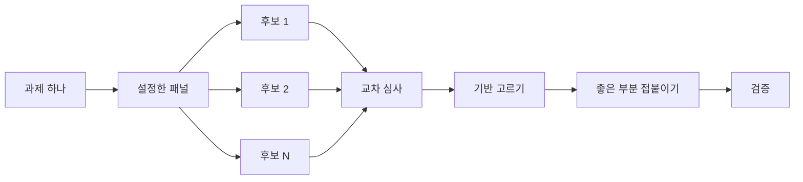

# 코드를 쓰기 전에 설계한다

어려운 설계를 한 번에 시도하면 모델이 처음 떠올린 모양이 굳는다. [`/dev:design`](../../skills/design/SKILL.md) 은 구현 전에 타입과 경계를 정한다. [`/dev:arena`](../../skills/arena/SKILL.md) 는 같은 과제를 여러 번 시도하게 한 뒤 가장 좋은 부분을 합친다. [`/dev:review`](../../skills/review/SKILL.md) 는 다른 모델들이 그 결과를 깨 보게 한다. 설계를 합치는 일이 아니라 빠짐없이 덮는 일이면 [`/dev:swarm`](../../skills/swarm/SKILL.md) 이 조각이나 경주로 펼치고 결과를 모은다.

가장 흔한 설계 실수는 둘이다. 에이전트의 첫 설계를 그대로 받는 것, 그리고 코드로 한 번도 시험하지 않은 계획을 다듬는 것이다. 이 장은 둘을 고친다. 계획은 코드로 세운다. 시제품이 열린 질문에 답하고, README 나 튜토리얼이 목표를 정하고, 글로 쓴 계획은 맨 마지막에 온다.


## `/dev:design` 으로 모양을 정한다

```text
/dev:design 코드 쓰기 전에 import 파이프라인부터 설계해. 호출하는 쪽이 어떻게 쓰는지가 제일 중요해.
```

`/dev:design` 은 먼저 변경이 닿는 시스템을 모두 따라가 본다. 그다음 타입, 시그니처, 모듈 경계를 갖춘 서로 다른 모양을 둘 그리고, 상태마다 주인이 하나이고 한 일에 길이 하나이며 호출자가 알아야 할 것이 가장 적은 쪽을 고른다. 설계가 크거나 의견이 갈리면 혼자 그리지 않고 `/dev:arena` 를 돌린다. 코드 전에 설계를 보고 싶으면 프롬프트에 그렇게 적는다.

코드를 쓰기 시작해도 설계가 신성하지는 않다. 같은 우회가 자꾸 돌아오면 `/dev:design` 은 덧대지 않고 다시 설계한다.

## `/dev:arena` 로 여러 시도를 펼친다

```text
/dev:arena 내 프롬프트를 그대로 겨루기에 올려. 다른 후보들 안과 네 안을 비교하고 싶어.
```

[`/dev:arena`](../../skills/arena/SKILL.md) 는 `/dev:design` 이 아래에서 쓰는 일반 도구다. 서브에이전트 N개가 같은 설계나 코드 과제를 병렬로 시도하고, 저마다 자기 워크트리나 폴더에 쓴다. 후보가 모두 끝나면 읽기 전용 심사자 하나가 채점 기준에 따라 모든 후보를 채점한다. 심사자는 부모 모델과 다른 계열의 모델이다. 그런 모델을 돌릴 수 없으면 심사를 건너뛰고 조정하는 쪽이 직접 기반을 고른다. 조정하는 쪽은 후보마다 끝까지 읽고, 기반 하나를 골라, 진 후보의 가장 좋은 생각을 접붙이고, 결과를 검증한다.



패널은 [`/dev:setup`](../../skills/setup/SKILL.md) 이 `~/.claude/rules/dev-models.md` 에 쓴 설정에서 오고, 일마다 바꿀 수 있다. 중요한 결정이면 후보를 늘리고, 아니면 줄인다.

```text
/dev:arena 이거 후보 5개로 겨뤄. 캐시 키 형식은 나중에 바꾸기 비싸.
```

## `/dev:swarm` 으로 조각과 경주를 덮는다

```text
/dev:swarm packages/ 아래 패키지마다 check.sh 로 확인해. 패키지 하나에 워커 하나. 보고서는 하나로.
```

`/dev:swarm` 은 워커 N개를 독립된 조각, 커버리지 표, 관문 레인, 탐색 구역, 미리 선언한 경주 팔에 펼친다. 워커마다 자기 범위와 검사를 받고, `PASS`, `ISSUES`, `BLOCKED` 가운데 하나로 보고한다. 부모는 워커를 모두 기다렸다가, 빈칸과 탈락까지 담은 짧은 보고서 하나를 돌려준다.

병렬로 돌려서 덮는 범위가 넓어지거나 독립된 검사끼리 경주하게 할 수 있을 때 쓴다. `/dev:arena` 는 모든 워커에게 같은 설계나 코드 과제를 주고, 기반을 골라 가장 좋은 부분을 접붙인다. `/dev:swarm` 은 조각을 덮거나, 선정 규칙을 미리 선언한 경주를 돌린다. 기반 고르기와 접붙이기 절차는 쓰지 않는다.

## `/dev:review` 로 깨 본다

```text
/dev:review 브랜치 전체를 의심하면서 봐. 진짜 버그나 회귀가 아니면 사소한 지적은 빼.
```

[`/dev:review`](../../skills/review/SKILL.md) 는 변경과 그 의도를 설정한 모델의 검토자들에게 주고, 검토자마다 실제 코드에 대고 돌려 보며 변경을 깨려 한다. 검토자마다 찾는 실패가 다르다. 지적은 그 명령을 다시 돌려 의도를 깨는 실패가 보일 때만 살아남는다. 보고는 검증된 지적마다 찾은 검토자를 붙이고, 이어서 검토자마다 버린 것과 그 이유를 적는다. 아무것도 고치지 않는다.

dismissed 목록도 읽는다. 판정은 뒤집을 수 있다.

## 논쟁하지 말고 시제품을 만든다

첫 설계를 그대로 받지 않는다. 몇 개를 달라고 하고, 눈으로 볼 수 있는 증거로 고른다.

```text
/dev:mode 새 드롭다운 메뉴 시안 몇 개를 프로토타입해 줘. 비교할 수 있게 스크린샷이나 영상 찍어 줘.
```

[프로토타입 플레이북](../../skills/mode/playbooks/prototype.md)은 scratch 폴더에 버릴 스케치를 만들고, 변형들을 스위처 하나 뒤에 두고, 하나씩 몰아 보며 스크린샷이나 타이밍을 잡는다. UI 만이 아니라 동작과 알고리즘에도 쓴다. 시제품은 코드로 세우는 계획이다. 에이전트가 사람에게 묻는 대신 무언가를 돌려서 자기 질문에 답하게 하고, 내가 떠올리지 못했을 선택지가 나올 자리를 남긴다.

같은 생각이 실제 설계로 커진다. `/dev:design` 에 시제품을 붙이고 리뷰 관문을 둔다.

```text
/dev:mode 외부 웹훅에 rate limiting 이 필요해. 먼저 /dev:design 으로 설계하고, 열린 질문은 시제품으로 답해. 진행하기 전에 내가 검토할게.
```

추상적인 계획에 검토자를 쓰지 않는다. `/dev:review` 는 실행으로 증명하지 못한 지적을 모두 버리므로, 뒤에 코드가 없는 계획에서는 깰 것이 별로 없다. 시제품으로 질문을 정하고, 그다음 만든 것을 리뷰한다.

## 함께 쓰는 코드는 README 부터 쓴다

다른 코드가 쓸 패키지나 API 는 사용자가 읽을 문서부터 시작한다.

```text
/dev:mode 새 config 패키지를 내가 어떻게 쓸지 튜토리얼부터 써. 그다음 /dev:teach 로 지금 것보다 왜 나은지 가르쳐 줘.
```

튜토리얼을 먼저 쓰면 호출하는 쪽의 눈으로 보게 된다. 가상의 사용자에게 API 를 설명하고, 거기서 거꾸로 구현으로 간다. 문서는 에이전트가 자기 일을 대어 볼 구체적인 목표도 된다. 문서 자체가 중요하면 [`/dev:write`](../../skills/write/SKILL.md) 를 이름으로 댄다. 그래야 튜토리얼이 참조와 설명을 한꺼번에 담는 쪽으로 흐르지 않고 튜토리얼로 남는다.

## 설계가 정해진 뒤에 계획한다

kit 에는 계획 스킬이 일부러 없다. 글로 쓴 계획이 필요하면 설계가 정해진 뒤에 요청한다.

```text
/dev:mode 이 설계를 계획으로 바꿔. 검증할 수 있는 작은 PR 들로, PR 마다 자기 검증 단계를 붙여.
```

[여러 단계 계획 플레이북](../../skills/mode/playbooks/multi-phase-plan.md)은 남은 열린 질문을 시제품으로 정한 뒤, PR 하나에 절 하나씩 쓰고 절마다 변경이 동작한다는 증명으로 끝낸다. 테스트 통과만으로는 그 증명이 되지 않는다. 계획이 산출물이다. 플레이북은 계획을 구현하지 않고, 실행은 내가 시작하라고 말할 때 시작한다.

이전 작업이면 기준을 프롬프트에 적는다.

```text
/dev:mode 우리 UI 라이브러리를 새 스타일 시스템으로 옮기는 계획을 세워. 검증할 수 있는 작은 PR 들로, PR 마다 시각 회귀 검사를 붙여. 결과는 원본과 똑같아야 해. 버그까지 포함해서.
```

「버그까지 포함해서」는 이전하면서 몰래 무언가를 고치지 않게 한다. 고치면 옛 출력과 새 출력을 비교할 수 없게 된다. 여러 날에 걸친 프로젝트면 계획을 한동안 저장소에 커밋해 두어 다른 에이전트도 진행 중인 일을 보게 할 수 있다. 일이 착지하면 지운다.

## 일마다 설계를 얼마나 할지 정한다

모든 변경에 이게 다 필요한지 궁금할 수 있다. 아니다. 대부분의 변경에는 하나도 필요 없다. 대략 이렇게 고른다.

- 다 끝냈는데 확신이 없는 작은 변경은 `/dev:review` 하나면 된다.
- 함수 경계를 넘거나 소유권을 옮기는 변경은 `/dev:design` 을 받는다. 설계가 크거나 의견이 갈리면 `/dev:arena` 가 따라온다.
- 이름, 형식, 알고리즘처럼 독립된 시도가 도움이 되는 따로 떨어진 결정은 바로 `/dev:arena` 로 간다.
- 커버리지 표, 병렬 검사 묶음, 팔을 선언한 경주는 `/dev:swarm` 이다.
- 배치, 타이밍, 접근처럼 무언가를 돌려서 답할 수 있는 열린 질문은 논쟁이 아니라 시제품을 받는다.
- 의견이 갈리고 되돌리기 비싼 설계는 `/dev:design` 을 하고, 내보내기 전에 `/dev:review` 를 한다.
- 여러 PR 에 걸친 일은 설계가 정해진 뒤에 쓴 계획을 받는다.

`/dev:mode` 는 이미 이 사다리를 따른다. 경계를 넘는 일이면 스스로 `/dev:design` 을 부르므로, 이 스킬들을 직접 부르는 것은 주로 기본보다 더 또는 덜 따져 보고 싶을 때다.

다음: [변경을 만들고 diff 를 정리한다](./05-build-and-clean.md).
