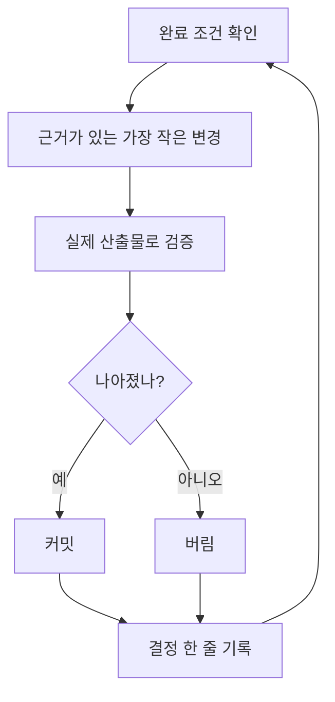

# 자는 동안 일을 돌린다

앞 장들이 모두 이 장을 위한 것이다. 자기 일을 스스로 검증한다고 믿을 수 있는 에이전트라면 어려운 일을 맡기고 자리를 비울 수 있다. 그것을 안전하게 만드는 건 바람이 아니다. 확인할 수 있는 완료 조건, 따로 떼어 둔 워크트리나 별도 Claude Code 세션, 그리고 아침에 감사할 결정 기록이다.


## 루프보다 믿음을 먼저 얻는다

믿지 못하는 루프는 확인 안 된 일을 더 빨리 만들 뿐이고, 엉망은 반복마다 쌓인다. 루프를 켜 두고 떠나기 전에 그 루프가 믿을 만한지 확인한다.

- 그 일을 한 번 손으로 해 봤거나 에이전트가 하는 것을 지켜봐서, 잘된 결과가 어떤 모습인지 안다.
- 에이전트가 내가 쓸 도구와 신호를 가졌다. 검증 스킬, 프로파일러, 로그.
- 단계마다 자기 일을 증명하고, 일이 기준에 못 미치면 줄을 세울 수 있다.
- 대화 기록 몇 개를 읽고, 되풀이된 실패를 도구, 스킬, 검사로 바꿔 두었다.

넷이 모두 맞을 때만 루프를 사람 없이 돌린다. 그전에는 지켜보면서 돌린다.

## 밤샘 계약

좋은 넘김에는 목표, 완료 조건, 권한, 비상구가 있다. 길 필요는 없다.

```text
/dev:mode 나 자러 간다. <base> 에서 새 워크트리를 따서 모든 호출부를 새 파서로 옮겨.
끝은 옛 호출부 0개, 파서 픽스처 전부 통과, 옛 API 삭제야.
결정 기록 남겨. 커밋 전에 나한테 묻지 마.
끝날 때까지 /loop 로 돌려. 몇 시간 해도 정말 막히면 멈추고 왜 막혔는지 적어.
```

줄마다 무엇을 얻는지 본다.

- 「나 자러 간다」는 세션 지시다. 에이전트는 묻기를 멈추고 계속 간다.
- 「끝은...」은 목표를 반복마다 돌릴 수 있는 검사로 바꾼다.
- 「`<base>` 에서 새 워크트리」는 이 실행이 내가 열어 둔 다른 일과 부딪치지 않게 한다.
- 「커밋 전에 나한테 묻지 마」는 에이전트가 기다리며 멈췄을 권한을 미리 답해 둔다.
- `/loop` 는 Claude Code 의 깨우기 스킬이고 kit 스킬이 아니다. [자율 실행 플레이북](../../skills/mode/playbooks/autonomous-run.md)이 이것으로 사건이나 심장박동마다 완료 조건을 다시 확인한다.
- 비상구가 있으면 진짜 막다른 길에서 멈추고 이유를 적는다. 여덟 시간 동안 목표를 창의적으로 다시 해석하는 것보다 낫다.

자리를 비운 뒤에 이 일을 검토할 것이므로 `/dev:mode` 는 이 일을 자기 [「맞춤 플레이북」 절](../../skills/mode/SKILL.md)로 보낸다. 거기서 코드보다 먼저 실행의 단계를 설계하고 결정 기록을 엮어 넣는다.

일부러 멈추려면 에이전트에게 잠깐 멈추라고 하거나, 곧 자리를 뜬다거나 Claude Code 를 다시 시작한다고 말한다. [안전하게 멈추기 플레이북](../../skills/mode/playbooks/pause-safely.md)이 지금 단계를 끝내거나 물리고, 작업 중 체크포인트를 `wip:` 커밋으로 남기고, 재개 노트를 쓴다. 새 대화는 그 노트에서 이어받기 플레이북으로 일을 다시 잡는다. 「계속해」는 절대 멈춤을 일으키지 않는다.

## 루프가 밤새 하는 일



반복마다 변경 하나, 검사 하나, 기록 한 줄이다. 도움이 안 된 변경은 남겨 두지 않고 버린다. 정체는 멈춤이 아니라 방향을 바꾸라는 신호이고, 완료 조건은 승리를 선언하려고 슬그머니 느슨해지지 않는다.

## 아침 감사

[`/dev:log`](../../skills/log/SKILL.md) 가 실행을 검토할 수 있게 만든다. 결정마다 한 줄에 무엇을, 왜, 근거, 결과를 적어 TSV 하나에 쌓는다. 파일은 작업 폴더의 `decisions.tsv` 이고, 여러 작업이 같은 폴더에서 돌면 `.audit/<작업 이름>.tsv` 다. 기본은 로컬에만 둔다. 리뷰어가 결과를 믿는 데 그 기록이 필요할 만큼 큰 일일 때만 커밋한다.

돌아오면 실행을 검토하기 좋은 모양으로 달라고 한다.

```text
/dev:log 어젯밤에 한 일 따라잡게 해 줘
```

이 스킬은 요약을 넘기기 전에 일을 한 모델과 다른 모델로 검토자를 띄워 기록과 대화 기록을 읽게 한다. 지금 쓸 수 있는 모델은 같은 회사 것이라 다양성이 약하고, 스킬이 그 점을 보고에 적는다. 답은 늘 「주의」 절로 끝나고, 첫 줄에 검토한 모델을, 그 아래에 눈여겨볼 것을 적는다. 그 절을 먼저 읽고, 그것이 가리키는 기록 줄을 읽는다. 밤 전체를 다시 읽는 게 아니라 결정을 감사하는 것이다.

감사 대신 짧은 현황만 원하면 일을 돌린 그 대화에서 [`/dev:catchup`](../../skills/catchup/SKILL.md) 을 부른다. 읽기만 하고, 내 마지막 메시지 뒤로 무엇이 바뀌었는지 쉬운 말로 알려 주며, 일이 만든 스크린샷과 작은 그림을 붙인다. 그다음 나를 기다리는 결정(머지, 승인, 선택지 고르기)을 하나씩 늘어놓고, 저마다 추천, 근거, 위험을 붙인다. 답장만 보고 결정할 수 있다.

## 밤에 할 일이 하나가 아니라 대기열이면

위 계약은 일 하나를 완료 조건 하나까지 몬다. 어떤 밤에는 더 많은 일이 있다. 서로 독립된 변경의 대기열이나 프로그램 전체다. 플레이북 둘과 맞춤 플레이북이 같은 믿음을 더 크게 키운다.

[오토파일럿 플레이북](../../skills/mode/playbooks/autopilot-full.md)은 독립된 PR 대기열을 머지까지 돌린다. PR 마다 담당 에이전트 하나가 만들기부터 머지까지 나르고, 어떤 담당도 자기 판정으로 머지하지 않는다. 새 검증자 스웜이 담당의 코드 준비 head 를 확인한다. 뒤이은 rebase 나 작은 수정은 새 검증자 하나를 받고, 새 동작이나 큰 새 diff 일 때만 전체 스웜을 다시 부른다. 머지할 패치에 대한 깨끗한 판정만이 머지를 허락한다.

```text
/dev:mode 이 대기열 전부 오토파일럿으로 머지까지 해. 항목은 서로 독립이야. 아침까지 머지돼 있으면 좋겠어.
```

[오토파일럿 스택 플레이북](../../skills/mode/playbooks/autopilot-stack.md)은 머지만 뺀 오토파일럿이다. 일어나면 판정이 붙은 검증된 PR 들이 있고, 검토와 착지는 내가 한다. PR 은 자기가 기대어 짓는 PR 위에만 쌓인다. 무엇이든 머지되기 전에 내 눈으로 보고 싶을 때 이쪽을 고른다.

```text
/dev:mode 이 변경 다섯 개 오토파일럿으로 해. 근데 머지는 하지 마. 아침에 내가 착지시킬게.
```

여러 패키지에 걸친 이전 같은 프로그램 전체에는 전용 플레이북이 없다. `/dev:mode` 는 크거나 여러 곳을 가로지르는 일을 「맞춤 플레이북」으로 보내고, 거기서 엄격한 실행 하나를 설계한다.

```text
/dev:mode 모든 패키지를 새 스토어로 옮겨. 하나하나 다 바뀌고 머지될 때까지 네가 맡아. 나는 하루에 두 번 들여다볼게.
```

## 여러 일을 나란히 돌린다

한 덩어리 일마다 Claude Code 세션 하나를 두고 그 세션을 지휘자로 쓴다. 지휘자는 코드를 쓰지 않는다. 서브에이전트를 지휘하고, 서브에이전트는 `isolation: "worktree"` 로 저마다 자기 워크트리에서 돈다. 노트북을 덮은 뒤에도 돌아야 하는 일은 Claude Code 원격 루틴(클라우드 세션)으로 띄운다. 지휘자에게 보내는 프롬프트를 `/dev:mode` 로 시작하면 지휘자가 띄우는 서브에이전트도 플레이북을 따른다. 지휘자가 띄우는 에이전트는 모두 [`worker.md`](../../skills/mode/worker.md) 를 먼저 읽는다. 그래서 워커는 킥오프의 기준을 지키고, 되돌릴 수 있는 선택은 묻지 않고 정하고, PR 을 리뷰 준비된 상태로 연다.

도움이 되는 습관이 몇 가지 있다.

- 기능, 이전, 성능 작업, 기술 부채 정리처럼 일 덩어리마다 세션을 따로 둔다. 여러 세션이 나란히 돌 수 있다.
- 관련된 지난 대화는 끝난 것까지 [`/dev:recall`](../../skills/recall/SKILL.md) 로 불러와 그 세션의 맥락으로 삼는다.
- PR 마다 머지 전에 검증 스웜을 붙이고, 대기열은 오토파일럿 스택이나 오토파일럿에 맡긴다.
- 지휘자에게 데이터에 기댄 계획을 달라고 하고, 나에게 묻기 전에 열린 질문은 시제품으로 답하게 한다.

프롬프트 하나가 조사부터 실행까지 한 덩어리 일 전체를 나를 수 있다.

```text
/dev:mode 이 저장소 구조를 에이전트가 다루기 쉽게 리팩터링해. 지난 커밋과 리뷰 코멘트에 /dev:correct 와 /dev:design 을 써서 여기서 에이전트가 가장 자주 하는 실수를 찾아. 지난 대화 맥락은 /dev:recall 로 가져와. 열린 질문은 나한테 묻지 말고 시제품으로 답해. 실제 데이터에 기댄 계획을 가져와. 내가 승인하면 autopilot-stack 이나 autopilot-full 로 돌리고, 어느 쪽으로 할지는 나한테 물어.
```

## 루프가 스스로 시작하게 한다

위의 루프는 모두 내가 시작해 주기를 기다린다. 일정이나 사건으로 도는 자동화가 그 단계를 없앤다. Claude Code 에서는 원격 루틴(일정 트리거, API 트리거)과 `/loop` 가 그 역할을 한다. 소프트웨어 유지보수는 이런 자동화에 잘 맞는 단계로 나뉜다. 보고를 분류하고, 재현하고, 고치고, 고침을 검증한다. 두 규칙이 이런 줄을 믿을 만하게 지킨다.

- 단계마다 줄을 세울 수 있다. 분류는 보고가 기대한 동작이라고 판단할 수 있고, 재현은 재현에 실패할 수 있고, 고치는 쪽은 변경이 너무 위험하다고 판단할 수 있다. 어느 결과든 쓸모가 있다. 나쁜 일이 되돌리기 더 비싼 다음 단계로 넘어가지 않게 막기 때문이다.
- 단계마다 증거를 넘긴다. 재현은 깨진 상태의 스크린샷과 영상을 붙이고, 고침은 전후 증거를 붙인다. 그러면 사람은 코드 한 줄 읽기 전에 에이전트가 맞는 것을 고쳤는지 확인할 수 있다.

kit 은 채널에 올라온 이슈 보고를 위해 이것을 스킬 둘로 담았다. [`/dev:triage`](../../skills/triage/SKILL.md) 는 보고마다 분류하고 원래 스레드에 판정 답글 하나를 단다. [`/dev:repro-fix`](../../skills/repro-fix/SKILL.md) 는 확인된 버그를 실제 UI 에서 재현하고, 재현한 뒤에만 범위를 정한 수정 초안 PR 을 낸다. 둘 다 원격 루틴으로 돌린다. 설정하려면 대상 저장소를 대고 `/dev:triage` 를 부른다. 설정이 없는 저장소면 그 스킬의 「처음 한 번 설정」 절이 루틴 준비까지 이끈다.

```text
/dev:triage 이슈 분류 설정해. 대상 저장소는 <저장소>야.
```

**함정:** 시간은 완료 조건이 아니다. 「4시간 동안 이거 해」는 에이전트에게 확인할 것을 하나도 주지 않고, 일어나 보면 결과 대신 네 시간 동안의 움직임만 남아 있다. `/loop` 에는 통과하거나 실패할 수 있는 술어를 준다.

다음: [원칙 이름으로 방향을 잡는다](./08-principles.md).
